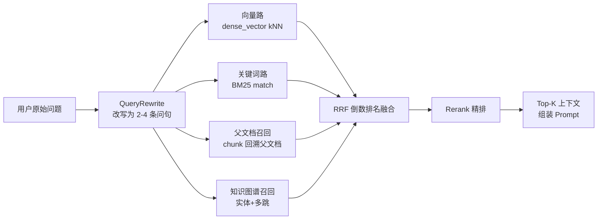

# Java Spring AI 企业级 RAG 检索实现

> 本文以开源项目[尚枢 AI（ShangShu AI）](https://github.com/jiangjiangbozan/ShangShu-AI)的真实代码为基础，完整拆解一条生产级 RAG 检索链路的设计与实现：Query 改写 → 向量 + 关键词双路召回 → RRF 融合 → Rerank 精排 → 父文档/知识图谱扩展，并给出基于 50 题数据集的量化评测数据。

## 一、为什么 RAG 链路值得单独讲

多数 RAG 教程止步于"文档切片 → 向量化 → Top-K 相似度检索 → 拼 Prompt"。这套 Demo 链路在真实企业数据上很快会暴露三个问题：

1. **用户问句不是文档语言**。用户写"这个接口报 500 啥情况"，文档里写的是"HTTP 500 错误码排查指引"。纯向量召回在语义模糊、口语化问句上召回率明显不足。
2. **专有名词、编号类 query 靠语义召回捞不到**。"工单 SLA-7 条款"这种精确串，BM25 关键词匹配比向量召回可靠得多。
3. **单路 Top-K 的排序质量不稳**。多路召回的结果天然无序，需要一个不依赖统一打分模型的融合算法。

尚枢 AI 的解法是把这几件事串成一条链路，全部跑在 Spring AI 抽象之上：模型接入走 `ChatClient`，向量库走 `VectorStore`，不锁定任何供应商。核心实现在 [RagRetrievalService.java](https://github.com/jiangjiangbozan/ShangShu-AI/blob/main/api/src/main/java/com/ai/api/knowledge/service/RagRetrievalService.java)。

## 二、整体链路



每个环节都可以通过配置项独立开关（`rag.query-rewrite.*`、`rag.rerank.*`），坏掉的路会被降级跳过而不是拖垮整体——这是企业级链路和 Demo 的核心区别。

## 三、第一步：Query 改写

改写器用轻量模型把一个原始问句扩写为 2-3 条语义等价的检索问句。实现要点全部在降级路径上（[QueryRewriteService.java](https://github.com/jiangjiangbozan/ShangShu-AI/blob/main/api/src/main/java/com/ai/api/knowledge/service/QueryRewriteService.java)）：

```java
public List<String> rewrite(String rawQuery) {
    if (!enabled || rawQuery == null || rawQuery.isBlank()) {
      return Collections.singletonList(rawQuery == null ? "" : rawQuery);
    }
    if (rawQuery.length() < minQueryLength) {
      return Collections.singletonList(rawQuery);
    }
    try {
      String prompt = buildPrompt(rawQuery);
      String response = callModel(prompt);
      List<String> parsed = parseResponse(response);
      if (parsed.isEmpty()) {
        return Collections.singletonList(rawQuery);
      }
      // 保证原 query 在结果中，避免改写偏离原意
      List<String> result = new ArrayList<>(parsed.size() + 1);
      result.add(rawQuery);
      for (String q : parsed) {
        if (!result.contains(q)) {
          result.add(q);
        }
      }
      // 限制最多 4 条（原 + 3 个改写）
      return result.size() > 4 ? result.subList(0, 4) : result;
    } catch (Exception e) {
      log.warn("[QueryRewriteService][改写失败，降级原 query: error={}]", e.getMessage());
      return Collections.singletonList(rawQuery);
    }
}
```

四个工程决策值得注意：

- **主备双模型**：主 `ChatClient`（DeepSeek）失败自动切备用（Ollama 本地模型），两次尝试都在一个 3 秒超时预算内；
- **短 query 不改写**：少于 6 个字符的问题改写收益为负，直接跳过省一次 LLM 调用；
- **原 query 永远保留**：改写是"扩展"而不是"替换"，防止模型改写偏离原意后检索方向彻底跑偏；
- **解析失败即降级**：模型输出按行 + 序号正则提取，提不出就返回原 query——改写环节永远不能成为检索的中断点。

## 四、第二步：多路召回

每个改写问句按配置的路数（`rag.query-rewrite.retrieval-methods`，默认 `semantic,fulltext`）各自召回。向量路走 Spring AI 的 `VectorStore.similaritySearch`：

```java
private List<Document> retrieveSemantic(String query, RetrievalFilter filter) {
    boolean needFilter =
        filter != null && (filter.kbId() != null || filter.hasDocumentConstraint());
    int top = needFilter ? topKPerQuery * FILTER_MARGIN : topKPerQuery;
    List<Document> hits =
        vectorStore.similaritySearch(
            SearchRequest.builder()
                .query(query)
                .topK(top)
                .similarityThreshold(0.5) // 相似度阈值，低于0.5直接丢弃
                .build());
    return applyStructuredFilter(hits, filter);
}
```

两个细节：

- **召回放大再裁剪**：当带有文档级过滤条件（fileType / documentId）时，先取 `topKPerQuery * 3` 再过滤裁剪回去，避免"先裁剪后过滤"把命中文档错误挤掉；
- **空路免疫**：任何一路抛异常只跳过该路（`retrieveByMethod` 内 catch 后返回空列表），不影响其他路，RRF 阶段空路天然不贡献分数。

除向量与 BM25 两路外，链路还预留了**父文档召回**（命中 chunk 回溯父文档 ±window 相邻分片补全段落语义）与**知识图谱召回**（实体匹配 + 多跳扩展）两条扩展路，同样由方法配置驱动。

## 五、第三步：RRF 融合

多路结果排序不一致，RRF（Reciprocal Rank Fusion）是最省事的融合方案——只看排名、不需要各路分数可比：

```java
// 3. 计算当前这一路每个文档的RRF贡献分
for (int i = 0; i < hits.size(); i++) {
    Document doc = hits.get(i);
    String id = doc.getId();
    docById.putIfAbsent(id, doc);
    /**
     * RRF公式：1/(k + rank) i是数组下标从0开始，rank排名从1开始，所以 i+1
     * delta = 当前这一路给这个文档贡献的分数 merge：多路的分数累加起来
     */
    double delta = 1.0 / (rrfK + (i + 1));
    rrfScore.merge(id, delta, Double::sum);
}
```

公式 `score(d) = Σ 1/(k + rank_i(d))`，平滑系数 k 默认 60（可配）。k 越大，各路排名先后对最终分数的影响越平缓——多路结果更均衡；k 小则头部排名权重更大。融合后按总分降序得到候选序列，再交给精排。

## 六、第四步：Rerank 精排与缓存

RRF 只解决"多路合并"，不保证"最能回答问题的片段排最前"。融合后接入 `RerankService` 二次精排，关闭时原序返回（`rag.rerank.enabled=false` 或 rerank 模型不可用时优雅降级）。缓存与反馈闭环也在这一层：相同 `(kbId, query)` 的检索结果缓存 5 分钟；命中文档异步批量回写命中计数（独立 Bean 保证 `@Async` 生效，按 vectorId 回写规避 UUID 主键解析缺陷），为后续反馈优化提供数据。

## 七、用数据说话：50 题评测

链路好不好不能靠感觉。我们构建了 `dev/rag-eval/` 评测套件：从知识库采样 chunk 用 LLM 生成问题 + 标注来源，逐题调用检索测试接口 `POST /api/v1/knowledge/{kbId}/retrieve-test`，该接口会逐步展开完整链路（`retrieveWithTrace`）并记录每步耗时。50 题数据集、topK=5 的结果：

| 阶段 | Recall@5 | MRR | nDCG@5 | 命中率 |
|---|---|---|---|---|
| 纯向量 | 0.480 | 0.350 | 0.383 | 48.0% |
| 纯关键词 | 0.800 | 0.577 | 0.634 | 80.0% |
| 向量+关键词+RRF | 0.780 | 0.491 | 0.563 | 78.0% |

完整报告见 [docs/rag-eval-report.md](https://github.com/jiangjiangbozan/ShangShu-AI/blob/main/docs/rag-eval-report.md)。两点解读：

- **双路互补性得到验证**：纯向量只命中 48%，而关键词路 80%——在我们的中文知识库语料上 BM25 意外地是主力。RRF 融合后 78%，略低于单关键词路，说明当一路显著弱于另一路时，RRF 的"均衡"会稀释强路收益；此时应调大 k 或调低弱路权重。这正是评测数据集的价值：不做评测，你不知道自己的数据该走哪条配置。
- **评测暴露了降级**：+Rerank 指标与纯向量完全一致，追查发现评测期间 rerank 处于降级关闭状态。评测套件顺带成了链路健康检查工具。

平均链路耗时 12.8 秒，主要开销在 QueryRewrite 的 LLM 调用与 ES 双路查询——对内部知识库问答场景可接受，缓存命中后收益显著。

## 八、小结

把这条链路拆开看，没有一步是"黑科技"，但每一步都有降级路径、可配置开关与量化验证。企业级 RAG 的竞争力不在单点算法，而在：

1. **可观测**：检索测试接口逐步展开每一步的输入输出与耗时；
2. **可降级**：改写失败、单路失败、精排关闭都不阻塞主链路；
3. **可验证**：固定数据集 + Recall/MRR/nDCG 指标，配置调整有据可依。

完整代码都在 [ShangShu-AI](https://github.com/jiangjiangbozan/ShangShu-AI) 仓库（Apache-2.0），欢迎 Star 与交流。

---

*发布渠道建议：本篇适合首发于掘金 / InfoQ / 公众号，标题可改为《我把 Spring AI 的 RAG 检索链路拆到了可评测的程度》；配图建议补充检索测试页面的链路展开截图。*
