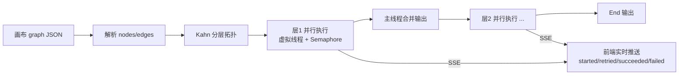

# 可视化工作流引擎设计

> 本文基于开源项目[尚枢 AI（ShangShu AI）](https://github.com/jiangjiangbozan/ShangShu-AI)的真实实现，拆解一个跑在 Spring Boot 上的可视化工作流引擎：DSL 解析 → Kahn 分层拓扑 → 虚拟线程并行执行 → 变量作用域 → 节点级重试 → 版本化快照。核心代码不足 500 行，但覆盖了多数"Dify 风格"编排器必需的工程决策。

## 一、引擎的全貌

用户在前端画布（Vue Flow）上拖拽节点、连线、配置参数，保存为一份 graph JSON（DSL）。引擎的工作是把这份 JSON 变成一次可观测、可恢复的执行：



实现在 [WorkflowEngine.java](https://github.com/jiangjiangbozan/ShangShu-AI/blob/main/api/src/main/java/com/ai/api/workflow/engine/WorkflowEngine.java)，节点执行器在 `api/src/main/java/com/ai/api/workflow/engine/node/` 下共 20 种（LLM、IfElse、Loop、Iteration、KnowledgeRetrieval、Agent、Code、HttpRequest 等）。以下按六个设计决策展开。

## 二、决策一：SPI 式节点注册，引擎不认识任何具体节点

最初版本引擎构造后逐个 `new` 20 种执行器，每加一种节点就要改引擎代码。重构后引擎只认接口：

```java
public WorkflowEngine(
    ObjectMapper objectMapper,
    @Value("${workflow.parallelism:" + DEFAULT_PARALLELISM + "}") int parallelism,
    List<NodeExecutor> executors) {
  this.objectMapper = objectMapper;
  this.parallelism = parallelism;
  this.executorMap = buildExecutorMap(executors);
}

private static Map<String, NodeExecutor> buildExecutorMap(List<NodeExecutor> executors) {
  Map<String, NodeExecutor> registry = new HashMap<>();
  for (NodeExecutor executor : executors) {
    NodeExecutor existing = registry.putIfAbsent(executor.type(), executor);
    if (existing != null) {
      throw new IllegalStateException(
          "Duplicate NodeExecutor type '"
              + executor.type()
              + "': "
              + existing.getClass().getName()
              + " vs "
              + executor.getClass().getName());
    }
  }
  return Map.copyOf(registry);
}
```

Spring 收集容器内**全部** `NodeExecutor` Bean 构建 `type → executor` 注册表。第三方扩展只需实现接口 + `@AutoConfiguration` 注册 Bean + 在 `META-INF/spring/...AutoConfiguration.imports` 声明，即可并入引擎，不改一行引擎代码（详见 [docs/workflow-node-spi.md](https://github.com/jiangjiangbozan/ShangShu-AI/blob/main/docs/workflow-node-spi.md)）。重复 type 直接启动失败——宁可 fail fast，也不要运行期节点被静默覆盖。

## 三、决策二：Kahn 分层拓扑 + 虚拟线程并行

DAG 执行的经典做法是拓扑排序后逐个执行。为了支持并行分支，这里用 Kahn 算法做**分层**拓扑：同层节点互不依赖，天然可并行。

```java
private List<List<NodeDef>> topologicalLayers(List<NodeDef> nodes, List<EdgeDef> edges) {
  // ... 构建 inDegree 与邻接表
  while (!frontier.isEmpty()) {
    processed += frontier.size();
    layers.add(frontier.stream().map(nodeMap::get).toList());
    List<String> next = new ArrayList<>();
    for (String id : frontier) {
      for (String nextId : adjacency.get(id)) {
        if (inDegree.merge(nextId, -1, Integer::sum) == 0) {
          next.add(nextId);
        }
      }
    }
    frontier = next;
  }
  if (processed != nodes.size()) {
    throw new IllegalArgumentException("Workflow contains cycle");
  }
}
```

执行层用虚拟线程 + 信号量限流，兼顾吞吐与下游保护：

```java
// 虚拟线程按任务创建成本极低，真正的并发上限由 Semaphore 控制，防止下游模型/DB 资源被打满
Semaphore permits = new Semaphore(Math.max(parallelism, 1));
ExecutorService pool =
    Executors.newThreadPerTaskExecutor(Thread.ofVirtual().name("wf-node-", 0).factory());
```

LLM 节点动辄数秒，两个互不依赖的分支并行执行可显著缩短整体耗时；并行度默认 4（`workflow.parallelism`），设为 1 即退化为串行——兼容了所有旧场景。

## 四、决策三：并发正确性靠"主线程合并"而不是分布式锁

并行最容易引入的 Bug 是共享集合的并发修改。这里的取舍非常明确：**工作线程只执行、不写共享状态**，所有结果包装成 `NodeOutcome` 由主线程在层间串行合并：

```java
// 等待整层结束后在主线程统一合并结果，共享集合只在主线程写，规避并发修改
for (Future<NodeOutcome> future : futures) {
  NodeOutcome outcome = future.get();
  if (outcome.error() != null) {
    if (firstFailure == null) {
      firstFailure = outcome.error();
    }
    continue;
  }
  executedNodes.add(outcome.node().id());
  variablePool.put(outcome.node().id(), outcome.outputs());
  finalOutputs.putAll(outcome.outputs());
  totalTokens += outcome.tokens();
}
```

两个例外各自有明确的同步手段：变量池底层是 `ConcurrentHashMap`（并行读、合并期写）；SSE 事件推送因下游 `SseEmitter.send` 非线程安全，`emit` 用 `synchronized` 串行化。**不要试图让所有东西都无锁——选清楚哪几个点是共享的，逐点用最简单的同步原语。**

## 五、决策四：变量系统三件套——引用、作用域、类型校验

节点间数据流动全靠变量表达式，实现在 [VariablePool.java](https://github.com/jiangjiangbozan/ShangShu-AI/blob/main/api/src/main/java/com/ai/api/workflow/engine/VariablePool.java)：

1. **两种引用语义**：整串恰好是 `${nodeId.key}` 时保留原始类型（List/Number 直接传递），混排文本时做字符串拼接；
2. **global 作用域**：workflow inputs 写入 `globalPut`，任意节点以 `${global.key}`、甚至 `${global.user.name}` 点分下钻引用，`global.` 前缀优先于 nodeId 匹配；
3. **类型化读取**：`resolveTyped(template, Class<T>)` 让路径缺失抛 `VariableNotFoundException`、类型不符抛 `VariableTypeMismatchException`——配置错误在执行早期以明确信息暴露，而不是变成下游一个隐式 null。

```java
public <T> T resolveTyped(String template, Class<T> expectedType) {
  Object value = resolve(template);
  if (value == null) {
    throw new VariableNotFoundException(template);
  }
  if (!expectedType.isInstance(value)) {
    throw new VariableTypeMismatchException(template, value.getClass(), expectedType);
  }
  return expectedType.cast(value);
}
```

## 六、决策五：节点级重试与 onError 策略

LLM 节点超时、HTTP 节点抖动是常态，"一失败就整条流程报废"在生产环境不可接受。引擎在节点外包装了一层重试循环，全部配置都来自画布节点数据（`node.data`）：

```java
int maxAttempts =
    (int) Math.max(1, readRetryNumber(node.data(), "maxAttempts", DEFAULT_MAX_ATTEMPTS));
long backoffMs = Math.max(0L, readRetryNumber(node.data(), "backoffMs", DEFAULT_BACKOFF_MS));
boolean continueOnError = ON_ERROR_CONTINUE.equals(readOnError(node.data()));
```

- `retry.maxAttempts` / `retry.backoffMs`：重试次数与退避间隔，每次重试发 `NODE_RETRIED` SSE 事件，前端可实时看到"第 2/3 次重试"；
- `onError: continue`：重试耗尽后节点记 `failed` 但流程继续走下游，适合"旁路增强"节点（如选填的摘要生成）；默认 `fail` 保持中断语义；
- **向后兼容**：旧 DSL 没有 retry/onError 字段时，默认值与重构前行为完全一致。

## 七、决策六：发布快照让版本不可变

工作流被 10 个 AI 应用引用，编辑画布不应影响已发布引用。方案是版本化快照：发布时把当前 graph 冻结为新版本（`wf_workflow_version` 表，UNIQUE(workflow_id, version)），执行时优先读最新发布快照、无快照回退草稿，运行记录 `wf_workflow_run.version` 标明实际执行版本。配合执行记录落库（每次运行的节点级状态、耗时、输入输出快照），前端可以按**当次执行使用的那个版本**的原始画布布局回放 DAG——编辑中的画布永远不会污染历史回放。

## 八、小结

这个引擎的每个决策都在回答同一个问题：**可视化编排从 Demo 到生产，差的是什么？** 差的不是更多节点类型，而是：

| 生产要求 | 对应设计 |
|---|---|
| 可扩展 | SPI 注册表 + 重复 type fail fast |
| 高性能 | Kahn 分层 + 虚拟线程 + 信号量限流 |
| 并发正确 | 主线程合并 + 最小化同步原语 |
| 可调试 | 变量类型异常显式抛出 + SSE 全事件推送 |
| 可靠 | 节点级重试 + onError 降级策略 |
| 可审计 | 版本快照 + 执行记录落库 |

完整代码在 [ShangShu-AI](https://github.com/jiangjiangbozan/ShangShu-AI) 仓库（Apache-2.0），工作流模块位于 `api/src/main/java/com/ai/api/workflow/`。下一篇计划拆解 AI 应用统一发布网关（OpenAI 兼容协议），欢迎关注。

---

*发布渠道建议：本篇适合首发于掘金 / InfoQ / 公众号"后端"栏目；配图建议补充前端画布截图与执行记录 DAG 回放截图，增强"可视化"说服力。*
